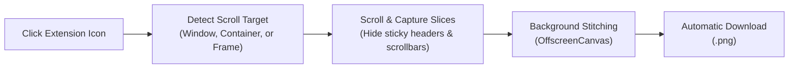

# Save Full Page as PNG

[](manifest.json)
[](LICENSE)
[](#)
[](manifest.json)

A lightweight, zero-build **Manifest V3** Google Chrome extension that captures an entire web page and saves it directly as a **single `.png` image file** with one click.

---

## Features

- **One-Click Instant Capture**: Click the toolbar icon to start capturing immediately—no popups, no options screens, and no intermediate tabs.
- **Universal Scroll & Stitch Engine**:
  - **Standard Web Pages**: Full support for standard `window` / `document` scrolling.
  - **Single Page Apps (SPAs)**: Automatically detects and scrolls inner scrollable containers (`overflow-y: auto | scroll`).
  - **Legacy Portals & Dashboards**: Uses multi-frame probing (`frame_helper.js`) to capture and stitch content inside nested `<frame>`, `<iframe>`, or `<frameset>` structures.
- **Smart Sticky & Fixed Header Suppression**: Captures fixed/sticky navigation bars once on the initial slice, then temporarily hides them on subsequent slices so they never repeat down the screenshot.
- **Live Badge Progress**: Shows real-time capture status directly on the extension icon (`0%` → `100%` → `DONE`).
- **Memory & Dimension Safeguards**: Proportional canvas scaling ensures giant web pages stay within browser memory limits without crashing.
- **100% Local & Privacy-First**: Zero external network requests, zero telemetry/analytics, and minimal browser permissions.

---

## How It Works



1. **Detection**: Upon clicking the toolbar icon, dynamic scripts measure the viewport and identify whether the primary content is on the window, inside a scrollable `<div>`, or wrapped in an inner frame.
2. **Scroll & Slice**: Slices are captured progressively using `chrome.tabs.captureVisibleTab`. Scrollbars and repeated sticky elements are temporarily suppressed.
3. **Stitch**: Captured viewports are drawn onto an `OffscreenCanvas` inside the background service worker.
4. **Export**: The final image is converted to a PNG blob and saved to your Downloads folder with a clean timestamped filename: `<Page-Title>_YYYY-MM-DD_HH-mm-ss.png`.

---

## Installation (Load Unpacked)

1. Clone or download this repository:
   ```bash
   git clone https://github.com/gda00/save-page-as-png.git
   ```
2. Open Google Chrome and navigate to `chrome://extensions/`.
3. Enable **Developer mode** using the toggle in the top-right corner.
4. Click **Load unpacked** in the top-left corner.
5. Select the `save-page-as-png` directory.
6. *(Optional)* Click the **Extensions** puzzle icon in Chrome's toolbar and pin **Save Full Page as PNG** for quick access.

---

## Usage

1. Navigate to any page you want to capture.
2. Click the **Save Full Page as PNG** extension icon in your toolbar.
3. Watch the badge on the icon track progress (`25%`, `50%`, `100%`).
4. Once completed (`DONE`), the `.png` screenshot will automatically appear in your Downloads folder.

---

## Permissions Breakdown

This extension adheres to the principle of least privilege:

| Permission | Purpose |
| :--- | :--- |
| `activeTab` | Temporarily accesses the active tab's visible viewport when you click the extension icon. |
| `scripting` | Injects local measurement scripts (`content.js`, `frame_helper.js`) to scroll the page and restore its state. |
| `downloads` | Saves the stitched PNG file directly to your local Downloads folder. |

---

## Packaging for Chrome Web Store & Releases

To create a clean zip package for the Chrome Web Store or a GitHub Release asset:

```bash
zip -r save-page-as-png.zip manifest.json background.js content.js frame_helper.js icons/
```

### Chrome Web Store Privacy Justifications
When publishing to the Chrome Web Store Developer Dashboard, use the following details:
- **Single purpose**: *"Captures the full height of the current web page and saves it as a single PNG image when the user clicks the extension icon."*
- **`activeTab` justification**: *"Grants temporary access to capture visible viewport slices of the active tab only when the user explicitly clicks the extension toolbar icon."*
- **`scripting` justification**: *"Injects the local scroll-and-measure helper (content.js and frame_helper.js) into the active tab on click to scroll through the page and restore the original scroll position afterward."*
- **`downloads` justification**: *"Saves the final stitched PNG image directly to the user's Downloads folder."*
- **Data usage**: Select *"No, I do not collect any user data"*.

---

## License

This project is licensed under the [MIT License](LICENSE).
